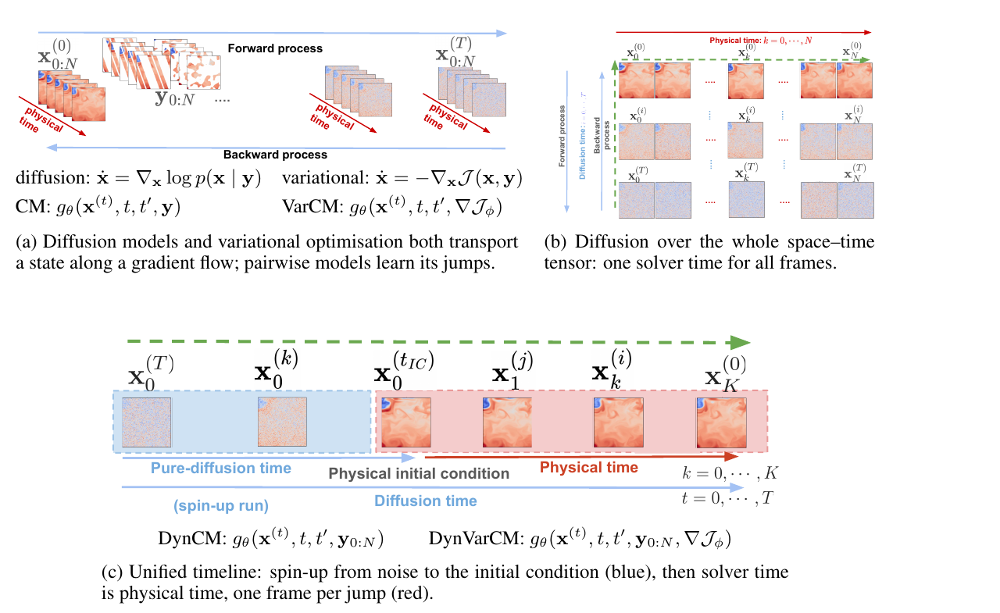
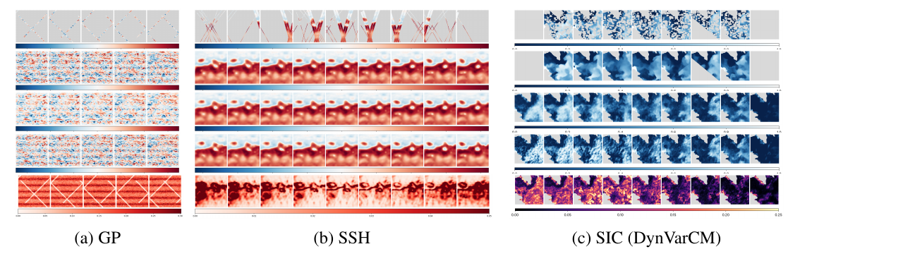
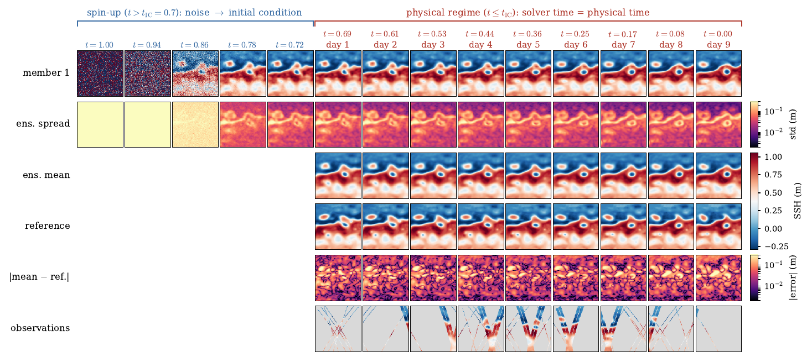
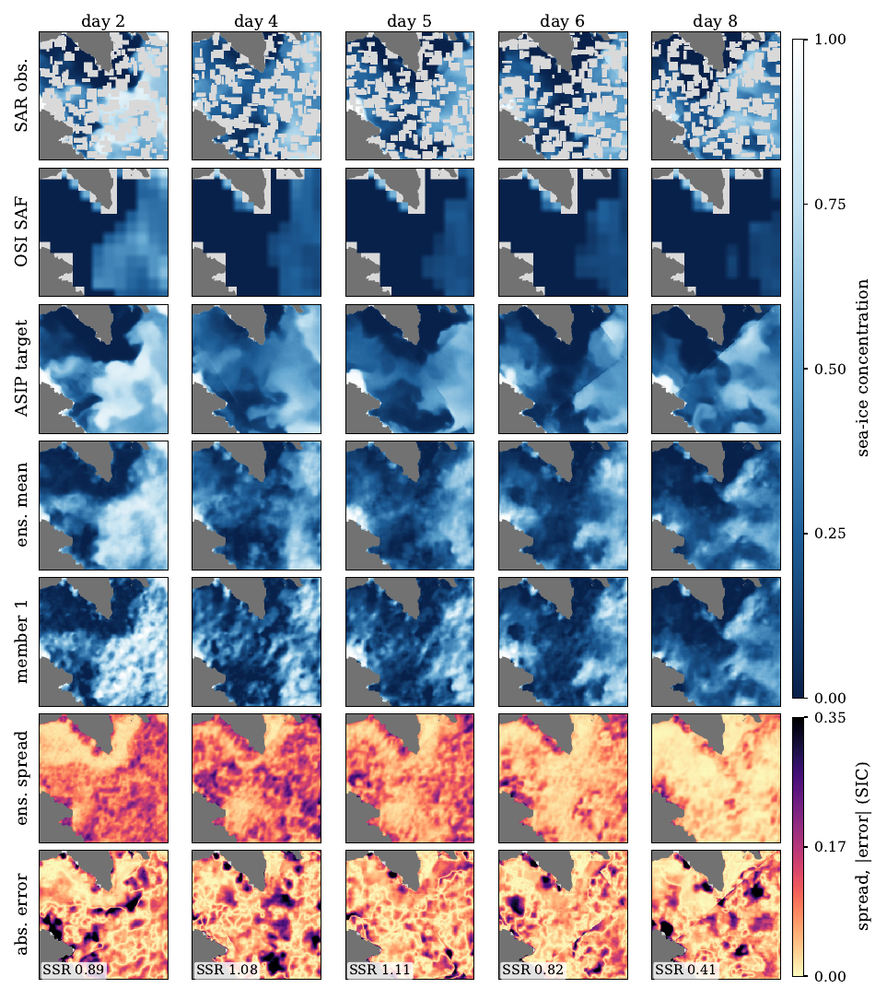
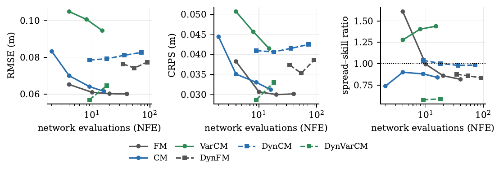

# Pairwise consistency models for Bayesian transport and variational data assimilation

Branch `consistency_models` of [4dvarnet-starter](https://github.com/maxbeauchamp/4dvarnet-starter): the code,
notebooks and results of the pairwise consistency models (CM, VarCM, DynCM, DynVarCM), their flow-matching teachers
(FM, DynFM) and the UNet / 4DVarNet baselines, on three benchmarks: a linear–Gaussian space–time process (GP), sea
surface height from altimetry (SSH, Gulf Stream) and sea-ice concentration from SAR retrievals (SIC). The state of the
ICLR 2027 rebuttal is tagged [`iclr2027-rebuttal`](https://github.com/maxbeauchamp/4dvarnet-starter/tree/iclr2027-rebuttal).



*Diffusion models and variational optimisation both transport a state along a gradient flow; pairwise models learn its
jumps $g_\theta(\mathbf x^{(t)}, t, t', \cdot)$ (a). Instead of diffusing the whole space–time tensor (b), the
space–time models use one clock: a spin-up jump from noise to the initial condition, then one jump per frame (c).*

## Methods

| Model | Trained from | Idea |
|---|---|---|
| **FM** / **DynFM** | reference states | flow matching (linear interpolant), static / space–time; teachers of CM / DynCM |
| **CM** / **DynCM** | FM / DynFM teacher | pairwise (two-time) consistency map distilled from the teacher's probability-flow ODE |
| **VarCM** / **DynVarCM** | reference states only | pairwise map conditioned on the gradient of a learned variational cost $\nabla\mathcal J_\phi$ at every jump; trained by self-consistency + a fair ensemble CRPS, no teacher, no forward process |
| UNet | reference states | direct regression (conditional mean) |
| 4DVarNet | reference states | learned variational solver |

DynCM and DynVarCM reconstruct a whole window (5 frames on GP, 9 days on SSH and SIC) with one network evaluation per
frame, the spin-up jump included.

## Examples



*One test window per benchmark, time from left to right: CM on GP and SSH, DynVarCM on SIC. From top to bottom:
observations, reference, ensemble mean, one member, ensemble spread.*



*DynCM on SSH: spin-up from noise to the initial condition (blue), then solver time = physical time, one jump per day
(red). Rows: one member, ensemble spread, ensemble mean, reference, error, observations.*

<p align="center"></p>

*DynVarCM on SIC (marginal ice zone): SAR observations, OSI SAF, ASIP reference, ensemble mean, one member, spread and
absolute error with the spread–skill ratio of each day.*

## Results

Full test sets, ensembles of 20 members. CRPS over all grid points; SSR: spread–skill ratio (1 for a calibrated
ensemble). The CSVs are in [`consistency/paper_results/`](consistency/paper_results).

| SSH (Gulf Stream) | RMSE (m) | λx (°) | CRPS | SSR | | SIC (MIZ) | RMSE | λx (px) | CRPS | SSR |
|---|---|---|---|---|---|---|---|---|---|---|
| FM | 0.059 | 1.12 | 0.030 | 0.82 | | FM | 0.144 | 137 | 0.090 | 0.71 |
| CM | 0.062 | 1.12 | 0.033 | 0.88 | | CM | 0.141 | 109 | 0.100 | 0.29 |
| VarCM | 0.092 | 1.46 | 0.041 | 1.44 | | VarCM | 0.175 | 133 | 0.095 | 0.83 |
| DynFM | 0.075 | 1.39 | 0.039 | 0.83 | | DynFM | 0.245 | 158 | 0.169 | 0.47 |
| DynCM | 0.079 | 1.50 | 0.042 | 0.98 | | DynCM | 0.245 | 175 | 0.199 | 0.13 |
| DynVarCM | **0.055** | 1.20 | **0.029** | 0.58 | | DynVarCM | 0.150 | 88 | **0.077** | **0.89** |
| UNet | 0.193 | – | – | – | | UNet | **0.106** | 90 | – | – |
| 4DVarNet | 0.075 | 1.35 | – | – | | 4DVarNet | 0.191 | **80** | – | – |

**GP.** The exact posterior of the generating SPDE is computed by
[`consistency/scripts/gp_exact_posterior.py`](consistency/scripts/gp_exact_posterior.py) (RMSE 0.216, CRPS 0.119,
SSR 1.00). The GP windows are overlapping windows of a single trajectory split at random, so test frames also appear
in training windows and the absolute GP scores of the learned models are optimistic; GP is used for relative
comparisons (distillation, calibration, number of network evaluations).

**Number of network evaluations.** DynCM keeps its accuracy and calibration from 9 to 72 evaluations on SSH (one per
frame suffices, against 34–90 for DynFM); CM needs about 9 evaluations to approach FM on SSH, a single one on GP.

<p align="center"></p>

## Repository layout

```
consistency/
├── consistency_models/        CM, VarCM, DynCM, VarDynCM (models, losses, samplers), sic_costs.py, teacher_targets.py
├── flowmatching_models/       FM / DynFM networks and Lightning modules
├── calibration.py             CRPS, spread–skill ratio, rank histograms
├── spectral_utils.py          spectral score and resolved scale λx
├── Notebooks/Notebooks_{GP,SSH_GF,SIC}/   one notebook per method and benchmark (first cell = parameters)
├── sbatch_submission/         run_training.py, run_metrics.py, run_nfe_sweep.py + methods.yaml
├── paper_results/             CSVs of the tables and NFE studies
└── scripts/                   figures, exact GP posterior, supplementary archive
src/                           data loaders (dataloader_SPDE.py, dataloader_SSH.py, dataloader_SIC.py)
odyssey/                       pilot to run the experiments on the Odyssey cluster from a laptop (see its README)
docs/figures/                  figures of this README
```

## Usage

```bash
conda env create -f environment.yaml && conda activate 4dvarnet-starter
cd consistency/sbatch_submission
python run_training.py --xp SSH_GF --method FM_aug --reset      # train (checkpoints in Notebooks_SSH_GF/<log_dir>/)
python run_metrics.py  --xp SSH_GF --method FM_aug              # evaluate: results/SSH_GF/FM_aug_metrics*.csv
python run_metrics.py  --xp SSH_GF --method CMT_aug --set NSTEPS_EVAL=5 --out-tag _nfe5   # override a parameter
```

[`methods.yaml`](consistency/sbatch_submission/methods.yaml) maps every row of the tables to its method key, notebook
and checkpoint folder. Teachers are trained before their students (FM before CM, DynFM before DynCM).

**Data** (in `data/`, not tracked): `SPDE_diffusion_dataset_1.nc` (GP, simulated from the SPDE),
`natl_gf_w_5nadirs_swot.nc` (SSH, built from the [2020a SSH mapping data
challenge](https://github.com/ocean-data-challenges/2020a_SSH_mapping_NATL60)), `asip_database_daw15_sparse.nc`
(SIC: ASIP fields, SAR retrievals and OSI SAF on a common grid).
